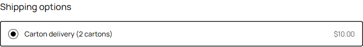

# Carton Shipping Demo for WooCommerce

An installable WordPress plugin that adds a per-carton shipping method to WooCommerce shipping zones. It uses one carton capacity and one price per zone. For example, 13 units at 12 per carton require two cartons, so a $5 carton rate appears as $10 at checkout.

## Try it locally

1. Copy the repository contents into a folder named **woo-carton-shipping-demo** under **wp-content/plugins** on a WordPress test site with WooCommerce.
2. Activate **Carton Shipping Demo for WooCommerce**.
3. In **WooCommerce → Settings → Shipping → Shipping zones**, add **Carton Shipping Demo** to a zone. Set **Units per carton** to **12** and **Price per carton** to **5.00**.
4. Add 12 then 13 units of a physical product with a shipping address in that zone. Checkout should show one carton at $5 and two cartons at $10, respectively, before any shipping tax.

## Implementation

The plugin registers a [native shipping method](https://developer.woocommerce.com/docs/features/shipping/shipping-method-api/) and uses WooCommerce's zone settings and rate API. The quote function counts full or partial cartons and is tested separately from WordPress. Each package uses its own physical-unit count, so virtual items do not consume carton capacity. WooCommerce calculates any applicable shipping tax.

## Checks

Run the nine calculation checks with PHP 8.2 or newer:

    php tests/quote-test.php

The shipping adapter was also checked against real WooCommerce product objects for full cartons, overflow units, mixed physical and virtual items, empty packages, virtual-only packages, and invalid settings. Both classic and block checkout displayed the expected 12-unit and 13-unit rates on WordPress 7.1.3, WooCommerce 11.1.2, and PHP 8.2.12.

## License

GPL-2.0-or-later. See [LICENSE](LICENSE).
